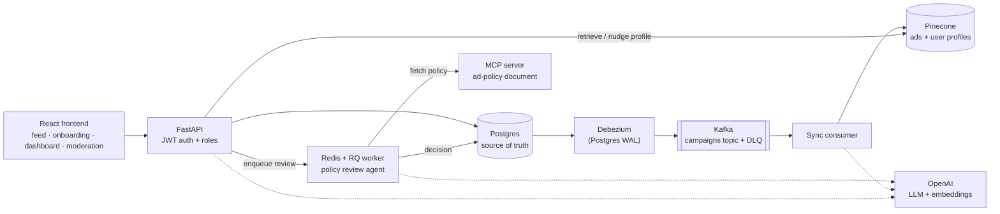

# Adaptive Ad Recommender

A full-stack, LLM-powered ad engine. Advertisers submit campaigns, an AI agent reviews them against a written ad policy, and approved ads are served to users through vector retrieval. Every reaction then reshapes that user's profile and charges the campaign's budget.

It is built like a production system rather than a notebook demo: Postgres as the source of truth, async jobs, change data capture into the vector store, real auth with roles, and tests that probe the LLM surfaces with actual prompt-injection attacks.

**Stack:** Python · FastAPI · PostgreSQL · SQLAlchemy/Alembic · Redis/RQ · Kafka + Debezium · Pinecone · OpenAI (`gpt-4o-mini`, `text-embedding-3-small`) · MCP · React · TypeScript · Vite · Tailwind · Docker Compose

---

## What it does

| Role | Experience |
| --- | --- |
| **End user** | Signs in with Google, describes their interests in a short chat, then scrolls an infinite feed of ads. Like / interested / dislike reactions move their profile vector, so the feed adapts in real time. They can hide ads, report them, or reset their profile. |
| **Advertiser** | Submits campaigns (headline, copy, category, budget, date window) and watches them move through review. A performance dashboard shows impressions, reactions, CTR trends and budget spend, with a searchable, sortable, paginated table across 3,000+ campaigns. |
| **Moderator** | Works a queue of campaigns the AI reviewer escalated, sees the agent's reasoning and research notes, and approves or rejects. |

## Architecture



There are three main flows.

**1. Campaign review (async, agentic).** `POST /campaigns` stores the row as `pending_review` and returns immediately. An RQ worker runs the policy reviewer:

- It fetches the current ad policy from an **MCP resource server**.
- It runs a bounded **tool-calling loop** with `gpt-4o-mini`, using OpenAI's hosted web search to verify factual claims plus a custom `lookup_advertiser_history` tool.
- It returns a schema-validated decision: `approved`, `rejected`, or `needs_review` for a human moderator.

**2. Postgres to Pinecone sync (CDC).** Nothing writes campaigns to the vector store directly. Debezium streams every change on the `campaigns` table into a compacted Kafka topic. A consumer then applies each change idempotently:

- It **re-embeds** only when a campaign becomes active or its creative changes.
- It only **patches metadata** for status or date changes.
- It **deletes** the vector when the row is deleted.
- Unprocessable events go to a dead-letter topic.

**3. Serving and learning.** `POST /recommend/batch` takes the user's profile vector and queries Pinecone. It then re-checks every candidate against Postgres (still active, budget left, inside the date window, not blocklisted, not shown in the last hour) and applies brand-safety guardrails. Reactions nudge the profile vector (`+0.15` like, `+0.30` interested, `−0.20` dislike) and debit the campaign's budget with an atomic SQL update.

## Engineering highlights

- **Prompt-injection testing against the real model.** There is a separate adversarial suite that attacks the policy reviewer and the onboarding judge with real, unmocked OpenAI calls. It found actual vulnerabilities:
  - Adding an "instructions vs. data" framing to the reviewer's prompt fixed its exposure (5/5 clean runs afterward).
  - Prompt hardening did *not* fix the judge (7/7 runs still failed). So the guarantee moved into code: a deterministic guard ensures a poisoned summary can never be persisted as a profile vector. → [docs/adversarial_testing_plan.md](docs/adversarial_testing_plan.md)
- **Postgres stays the source of truth, Pinecone is derived.** Eligibility is always re-checked in Postgres at serve time, so lag in the vector store can never serve a paused or over-budget ad. The CDC design was load-tested with 300 campaigns through their full lifecycle (about 1,200 Kafka events): **zero processing errors and zero drift** between the two stores. p50 latency was 0.36s for a metadata patch and 0.93s for a re-embed. → [docs/kafka_cdc_plan.md](docs/kafka_cdc_plan.md)
- **Decisions backed by measurement.** LLM re-ranking is built (`serving/ranking.py`) but switched off in the feed. Measured, it added about 10s per batch and didn't reliably score every candidate, which wasn't worth it over similarity order. The reasoning is in the code.
- **Agent guardrails in code, not just prompts.**
  - The reviewer's tool loop is capped at 4 turns.
  - Tool arguments that matter, such as which advertiser's history to read, come from the server, never from the model.
  - Structured output is validated with Pydantic.
  - Transient failures are retried with `tenacity`.
- **Real auth.** Google OAuth issues the project's own JWT access and refresh tokens, with `end_user` / `advertiser` / `moderator` role gating. `user_id` always comes from the token and is never trusted from the request body. → [docs/auth_plan.md](docs/auth_plan.md)
- **Operational details.**
  - The sync consumer logs its lag as a heartbeat read from the broker's committed offset.
  - Profile updates are locked per user.
  - Campaign creation is rate limited (10/hour per account).
  - Recommendation and review decisions are logged as structured JSON.

## Tech stack

| Layer | Choice |
| --- | --- |
| API | FastAPI, Pydantic |
| Data | PostgreSQL 16, SQLAlchemy 2, Alembic |
| Async jobs | Redis + RQ |
| Streaming / CDC | Kafka 4 (KRaft, no ZooKeeper) + Debezium 3 |
| Vector search | Pinecone (serverless, cosine, 1536-d) |
| LLM | OpenAI Responses API, `gpt-4o-mini`, `text-embedding-3-small` |
| Agent tooling | MCP (`langchain-mcp-adapters`), native OpenAI function calling, hosted web search |
| Auth | Google Identity Services, PyJWT |
| Frontend | React 19, TypeScript, Vite, Tailwind CSS 4, React Router |
| Testing | pytest: 139 default tests, plus 1 Kafka integration test and 7 adversarial LLM tests |
| Dev environment | Docker Compose, Makefile |

## Running locally

### Prerequisites

- Docker, Python 3.12, Node 24
- An **OpenAI** API key
- A **Pinecone** index: 1536 dimensions, cosine metric
- A **Google OAuth client ID** (Web application, with `http://localhost:5173` as an authorized origin)

### 1. Configure

```bash
make install                                   # backend venv + frontend npm install
cp backend/.env.example backend/.env           # OPENAI_API_KEY, PINECONE_*, GOOGLE_CLIENT_ID, JWT_SECRET
cp frontend/.env.example frontend/.env         # VITE_API_BASE_URL, VITE_GOOGLE_CLIENT_ID
```

### 2. Start the infrastructure, then migrate and seed

```bash
make infra                      # Postgres + Redis
make kafka                      # Kafka + Debezium Connect
make kafka-register-connector   # wait until `curl localhost:8083/connectors` responds first; safe to re-run
make migrate                    # Alembic migrations
make seed                       # optional: ~3,300 demo campaigns
```

### 3. Run the app

Pick **one** of the two options. Both use the same Postgres, Redis and Kafka containers and the same data, so you can switch between them freely. Just don't run both at once, or they'll fight over ports 8000 and 5173.

**Option A: native processes (best for development).** Run each in its own terminal:

```bash
make backend          # API         → http://localhost:8000  (OpenAPI docs at /docs)
make worker           # campaign review worker
make kafka-consumer   # Pinecone sync consumer
make frontend         # web app     → http://localhost:5173
```

**Option B: everything in Docker.**

```bash
make docker-up        # postgres, redis, kafka, connect, backend, worker, consumer, frontend
```

Migrations, seeding and connector registration (step 2) still run from the host.

> **Note:** a campaign only becomes servable once the sync consumer has processed its approval. If the consumer was stopped for a while, it replays the backlog when it restarts. Check progress with `docker compose exec kafka /opt/kafka/bin/kafka-consumer-groups.sh --bootstrap-server kafka:9092 --describe --group pinecone-campaign-sync`.

### Optional tools

```bash
make pgadmin          # Postgres web GUI → http://localhost:5050 (admin@example.com / admin)
make help             # every available command
```

## Tests

```bash
make test               # 139 tests, real Postgres, OpenAI/Pinecone/MCP mocked at their boundaries
make test-integration   # end-to-end Kafka CDC test (needs the Kafka stack + a small real OpenAI call)
make test-adversarial   # real prompt-injection attacks against the live model (costs real API money)
```

DB-backed tests run against real Postgres, not SQLite, so constraints, atomic updates and indexes behave the same as in production.

## Project layout

```text
backend/
  app/
    core/          config, db, auth, queue, embeddings, vector store, rate limiting
    campaigns/     submission API, policy review agent, RQ jobs, Kafka→Pinecone consumer
    serving/       recommend, retrieval, guardrails, feedback, onboarding chat, events, performance
  mcp_servers/     ad-policy MCP resource server
  alembic/         migrations
  scripts/         seed-catalog generation, feedback simulation
  tests/
frontend/src/
  pages/           Login, Onboarding + Feed, Campaigns, Performance, Moderator
  components/      Feed, FeedCard, OnboardingChat, CtrTrendChart, ReportModal, …
kafka/connectors/  Debezium connector config
docs/              design docs and decision logs
```

## Design docs

The `docs/` folder records each major decision: what was measured, what went wrong along the way, and why things ended up the way they are.

- [spec.md](docs/spec.md): overall design and data model
- [kafka_cdc_plan.md](docs/kafka_cdc_plan.md): CDC pipeline, bugs found in live verification, latency and load-test results
- [adversarial_testing_plan.md](docs/adversarial_testing_plan.md): prompt-injection test plan, findings and fixes
- [auth_plan.md](docs/auth_plan.md): OAuth + JWT + role model
- [future_ideas.md](docs/future_ideas.md): known limitations and what I'd build next
